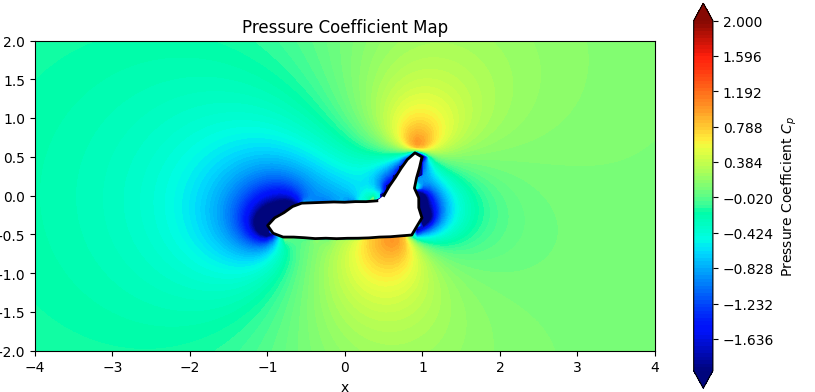
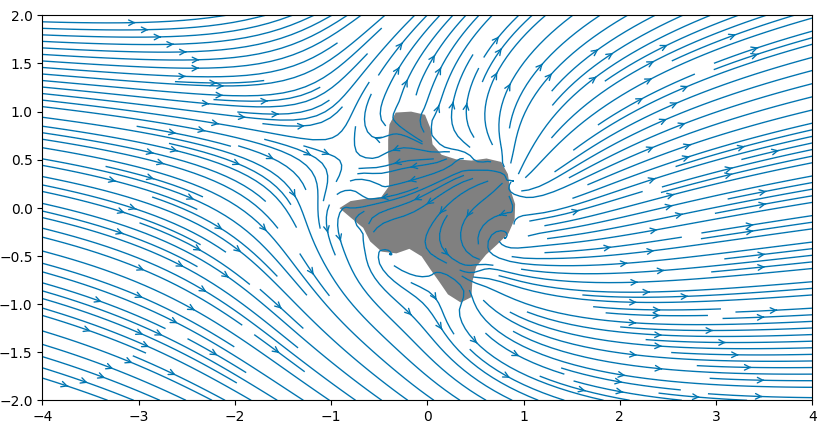

# 2D Aerodynamic Panel Flow Solver 🚀💨

A computational fluid dynamics (CFD) potential flow solver built in Python. This project utilizes the **source panel method** to model inviscid, incompressible flow over arbitrary 2D geometries. It computes boundary source strengths, extracts vector velocity fields, and visualizes pressure coefficient ($C_p$) distributions to analyze flow separation and aerodynamic efficiency.

## 📊 Analytical Scope
This solver was engineered to evaluate and contrast the aerodynamic performance of variable geometries—from streamlined aerospace vehicles (Space Shuttle Discovery) to highly bluff, non-aerodynamic shapes (a geographical map of Texas).

* **Velocity Field Extraction:** Maps velocity gradients to identify flow acceleration zones across leading edges.
* **Streamline Analysis:** Visualizes attached laminar flow versus turbulent stagnation regions.
* **Pressure Coefficient ($C_p$):** Calculates surface and field pressure distribution to isolate high-drag zones and blunt-face stagnation points.

---

## 🏗️ Computational Architecture

### 1. Panel Discretization (`define_panels`)
The algorithm ingests boundary coordinates from a `.csv` file and discretizes the geometry into $N$ linear panels. It calculates the control point, length, orientation angle ($\phi$), and normal vector ($eta$) for each discrete boundary segment.

### 2. Linear System & Source Strengths (`solve_source_strengths`)
A linear system of equations $[A][\sigma] = [b]$ is generated to satisfy the flow tangency boundary condition (velocity normal to the surface must be zero). 
* The influence matrix $[A]$ is populated by analytically integrating the velocity induced by the source sheet of panel $j$ onto the control point of panel $i$ using `scipy.integrate.quad`.
* The system is solved via `numpy.linalg.solve` to determine the unique source strength ($\sigma$) for every panel.

### 3. Field Computation (`compute_velocity_field`)
With the source strengths resolved, the global velocity field ($u$, $v$) is computed across a dense $100 \times 100$ coordinate meshgrid. The algorithm transforms local panel coordinates back into the global frame, superimposing the freestream velocity ($U_{\infty}$) with the induced velocities from all panels.

---

## 📸 Visualization Outputs

### Pressure Coefficient ($C_p$) Mapping
Evaluated using the dimensionless parameter: 
$$ C_p = 1 - \frac{u^2 + v^2}{U_{\infty}^2} $$
Highlights distinct stagnation points ($C_p = 1.0$) at the leading edges and intense flow acceleration (low pressure) regions over cockpit/wing contours.


*Figure 1: Pressure Coefficient contour map over the Space Shuttle Discovery.*

### Streamline Topography & Flow Separation
Demonstrates massive stagnation regions on the windward side and chaotic separation triggered by sharp, non-aerodynamic concave edges on a bluff body.


*Figure 2: Velocity streamlines demonstrating turbulent flow separation over a bluff geometry.*

---

## 🛠️ Setup & Execution

### Prerequisites
* Python 3.9+
* Required Libraries: `numpy`, `pandas`, `matplotlib`, `scipy`

### Installation
```bash
git clone https://github.com/yourusername/2D-Aero-Panel-Solver.git
cd 2D-Aero-Panel-Solver
pip install -r requirements.txt
```

### Run the Simulation
Place your boundary coordinate file (e.g., `spaceship.csv`) in the `data/` folder and execute the solver:
```bash
python src/solver.py
```
Output visualizations will be automatically saved to the `assets/` directory.
